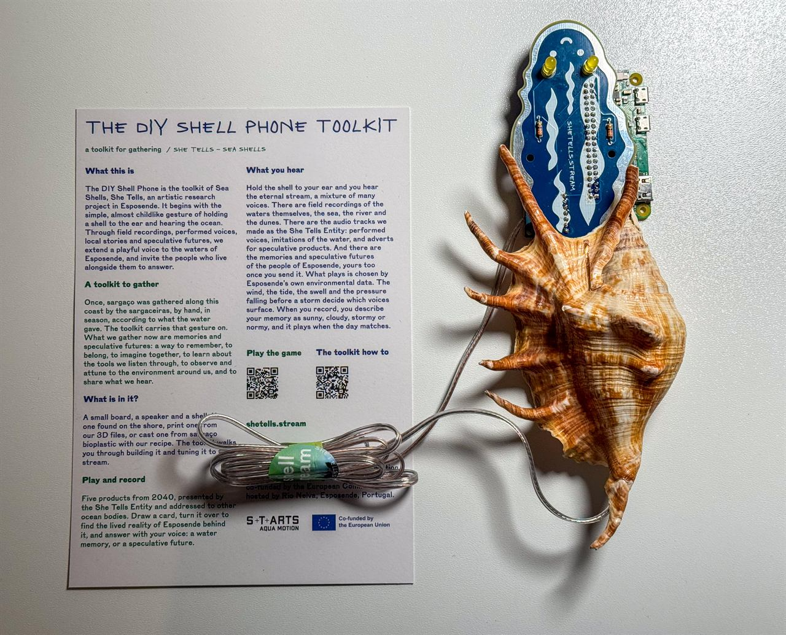
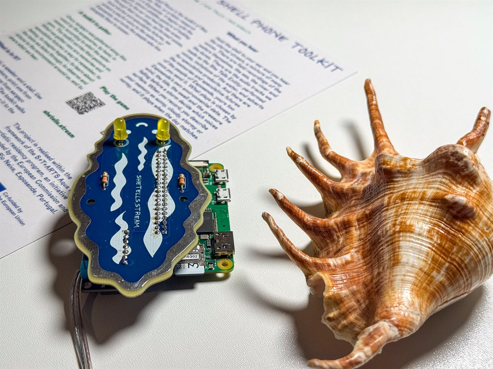
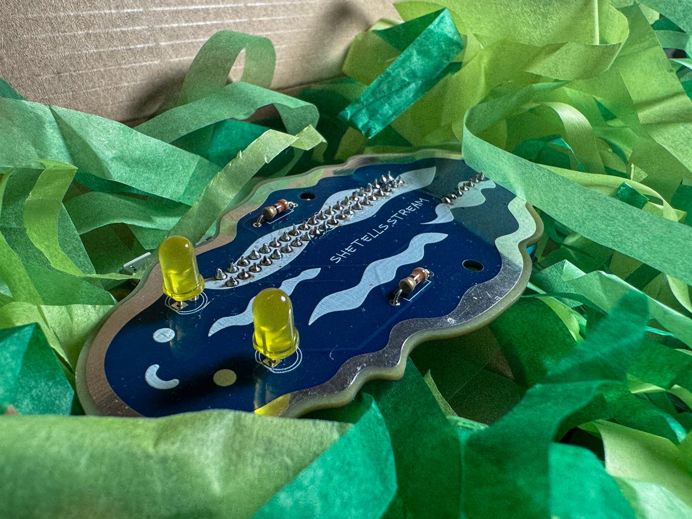
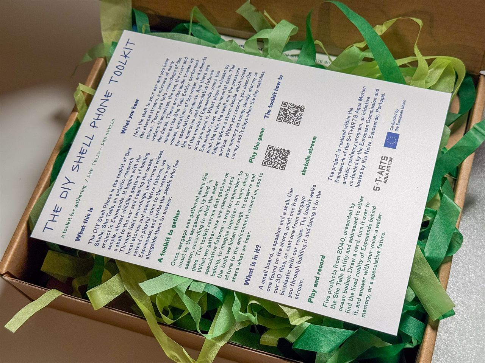
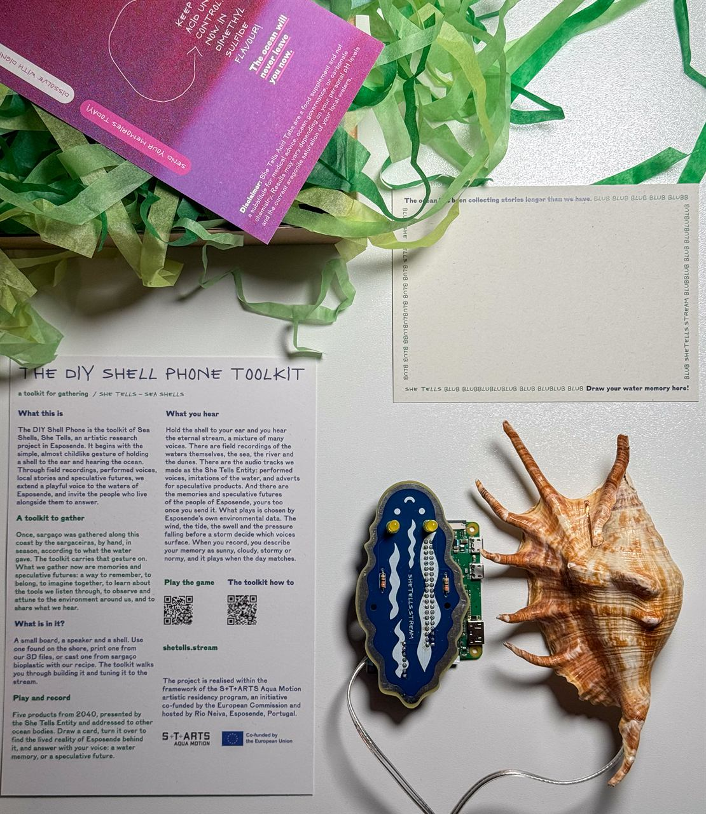
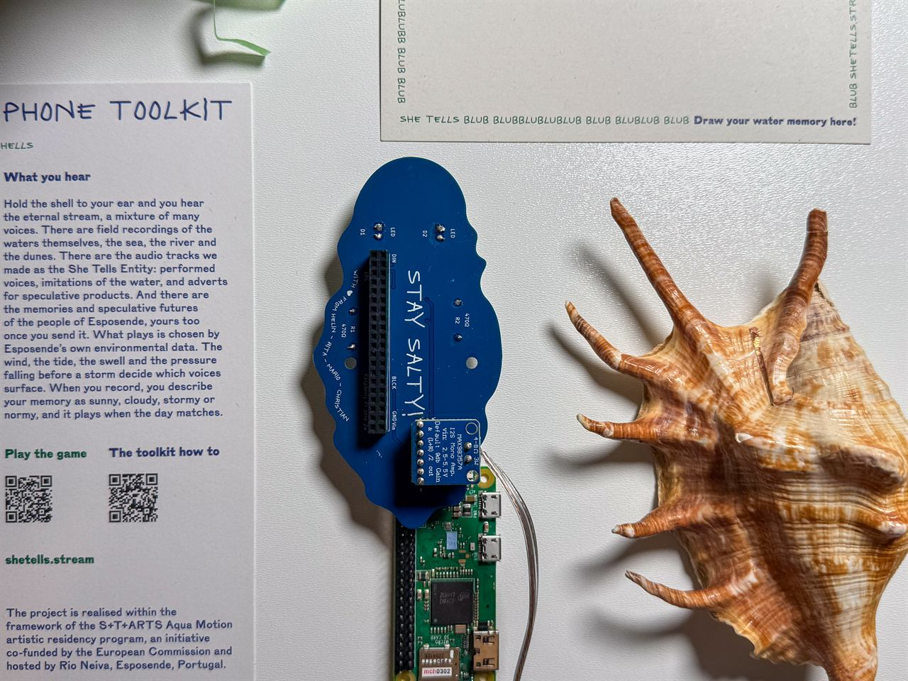

# 🐚 DIY Shell Phone

This repository is the open-source reference for the *DIY Shell Phone*, so anyone can build their own.

The DIY Shell Phone is the toolkit of **[Sea Shells, She Tells](https://shetells.stream/)**, an artistic research project in Esposende. It begins with the simple, almost childlike gesture of holding a shell to the ear and hearing the ocean. Through field recordings, performed voices, local stories and speculative futures, we extend a playful voice to the waters of Esposende, and invite the people who live alongside them to answer.

  
  
  

> **Building a kit?** Start with the **[Assembly guide](docs/assembly.md)**, then the **[Wi-Fi setup](docs/wifi-setup.md)**.

---

## About the project

**English** - The Shellphone is a shell you can listen to. Inside a shell sits a Raspberry Pi Zero W (or Zero 2 W) and a small custom audio board. When you hold the shell to your ear, it connects over WiFi to [shetells.stream](https://shetells.stream/) and plays its live **[stream](https://shetells.stream/stream.html)** - a flow of voices and memories that people have shared about water: the sea, rivers, drought, the things we are losing. It turns a familiar gesture - listening to a shell - into a way of listening to each other, and to the water. *(You can also explore the [Living Archive](https://shetells.stream/living-archive.html) to see the memories and the process behind the piece.)*

**Português** - O Shellphone é uma concha que se pode escutar. Dentro de uma concha estão uma Raspberry Pi Zero W (ou Zero 2 W) e uma pequena placa de áudio feita à medida. Ao aproximar a concha do ouvido, liga-se por WiFi a [shetells.stream](https://shetells.stream/) e reproduz a sua **[transmissão ao vivo](https://shetells.stream/stream.html)** — um fluxo de vozes e memórias que as pessoas partilharam sobre a água: o mar, os rios, a seca, aquilo que estamos a perder. Transforma um gesto familiar - ouvir uma concha - numa forma de nos ouvirmos uns aos outros, e de ouvir a água. *(Também podes explorar o [Arquivo Vivo](https://shetells.stream/living-archive.html) para ver as memórias e o processo por detrás da peça.)*

---

## How it works

The Shellphone is three parts, hidden inside a shell:

1. **Raspberry Pi Zero W or Zero 2 W** - a tiny WiFi computer. It connects to the internet and plays the live [stream](https://shetells.stream/stream.html) from [shetells.stream](https://shetells.stream/).
2. **Custom audio board** - a small PCB that plugs onto the Pi like a "HAT". It carries a **MAX98357A I2S amplifier** that turns the Pi's digital audio into a real signal, plus two LED "antennas" that light up whenever the Shellphone has power. The board is shaped like a snail.
3. **Bone-conduction transducer** (8 Ω, 1 W) - instead of a normal speaker, a small transducer that makes whatever it touches vibrate. Glued inside the shell, it turns *the shell itself* into the speaker, so the sound seems to rise out of the shell in your hand.

Any shell works: a real seashell or the 3D-printable one in [`enclosure/`](enclosure/). Everything is powered over USB (5 V).

  
  

The audio board connects to the Pi's audio pins like this:

| Amp signal | Raspberry Pi pin |
|---|---|
| Audio clock (BCLK) | GPIO18 (pin 12) |
| Word select (LRC) | GPIO19 (pin 35) |
| Audio data (DIN) | GPIO21 (pin 40) |
| Power (Vin) | 5V (pin 2) |
| Ground (GND) | GND (pin 6) |

The two LED antennas are wired from 5 V through a 470 Ω resistor each to GND, so they are always on when the board has power (they are not controlled by the Pi).

*(Full board design: [`hardware/pcb/`](https://github.com/marioguzzzman/diy-shell.phone/tree/main/hardware/pcb), a KiCad project.)*

---

## What's in this repo

| Folder / file | What's inside | Status |
|---|---|---|
| [`docs/assembly.md`](docs/assembly.md) | Step-by-step assembly guide with photos | ✅ |
| [`docs/wifi-setup.md`](docs/wifi-setup.md) | Connecting the Shellphone to Wi-Fi | ✅ |
| [`hardware/pcb/`](https://github.com/marioguzzzman/diy-shell.phone/tree/main/hardware/pcb) | KiCad design files for the audio board | ✅ Designed |
| [`hardware/bom.md`](hardware/bom.md) | Bill of Materials - the full parts list | ✅ |
| [`enclosure/`](enclosure/) | 3D-printable shell (`.3mf`, `.obj`), optional | ✅ Included |
| [`images/`](https://github.com/marioguzzzman/diy-shell.phone/tree/main/images) | Build photos and board renders | ✅ |
| **Software** | Comes pre-installed on the kit's SD card | 🚧 Instructions for flashing your own card coming |

---

## Build your own

  
  
  

1. **Get the parts** - see the [Bill of Materials](hardware/bom.md).
2. **Make the audio board** - open the KiCad project in [`hardware/pcb/`](https://github.com/marioguzzzman/diy-shell.phone/tree/main/hardware/pcb), export the Gerber files, and send them to any PCB fab (e.g. JLCPCB, PCBWay).
3. **Find a shell** - any shell works, or print the model in [`enclosure/`](enclosure/).
4. **Assemble** - follow the **[Assembly guide](docs/assembly.md)**: solder the board, plug it onto the Pi, and hot-glue the bone-conduction transducer inside the shell.
5. **Connect it to Wi-Fi** - see **[Wi-Fi setup](docs/wifi-setup.md)**.

---

## Software

The kit comes with a **pre-flashed SD card**: the software that connects to Wi-Fi and plays the stream is already on it. 🚧 Instructions for making your own pre-flashed card are coming.

---

## Credits

Made by:

- **Helin Ulaş** - [helinulas.info](https://helinulas.info/)
- **Rita Eperjesi** - [rita.cloud](https://rita.cloud/)
- **Mario Guzman** - [mario-guzman.com](https://www.mario-guzman.com/)
- **Christian Kokott** - [kokott.art](https://kokott.art/)

Co-funded by the European Union within the [S+T+ARTS Aqua Motion](https://starts.eu/what-we-do/residences/startsaquamotion/) residency, hosted by [Rio Neiva](https://rioneiva.com/), Esposende.
