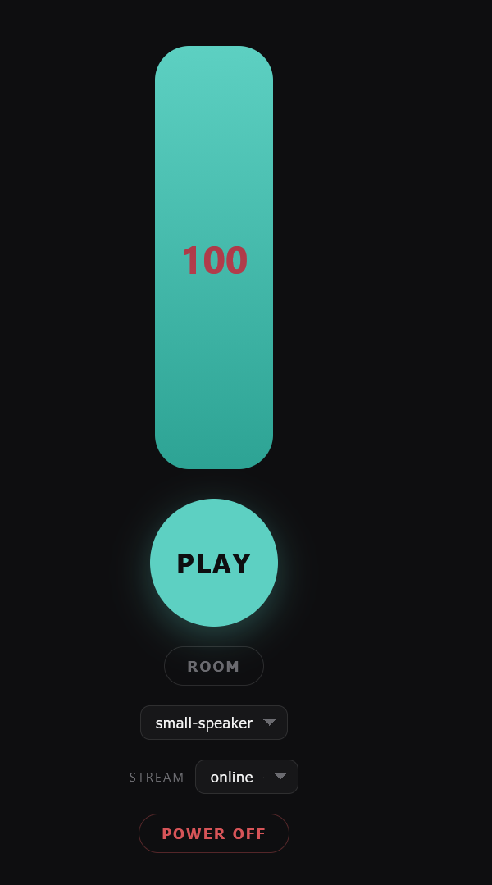

# Wi-Fi setup

The Shellphone plays a live stream from the internet, so it needs Wi-Fi.
This page explains how to connect it, and how to add a new Wi-Fi when you take
your shell somewhere else.

Build it first: see the **[Assembly guide](assembly.md)**.

---

## Your shell's name

Every Shellphone has its own name: `shell-phone-` plus a number, for example
`shell-phone-3`. On this page, **N stands for your shell's number**. So if
your shell is `shell-phone-3`, then `shell-phone-N-setup` means
`shell-phone-3-setup`.

Don't know the number? Switch the shell on somewhere without a known Wi-Fi.
The setup network it creates (see below) shows the name in your phone's Wi-Fi
list.

## Switching it on

Plug in the power supply. The antennas light up straight away, but the Pi needs
**about 2 minutes** to start, join the Wi-Fi and start playing. Be patient
before you decide something is wrong.

If the shell finds a Wi-Fi it already knows, it connects and plays on its own.
Nothing else to do.

---

## Adding a new Wi-Fi from your phone

When the shell can't find any Wi-Fi it knows, it creates **its own setup
network** so you can tell it about a new one. No laptop needed.

1. Switch on the shell and wait about **2–3 minutes** (start-up, plus about
   1 minute of looking for known networks).
2. On your phone, open the Wi-Fi settings and connect to:
   - **Network:** `shell-phone-N-setup`
   - **Password:** `shellphone`
3. A setup page opens by itself. If it doesn't, open
   **<http://10.42.0.1/>** in your phone's browser.
4. Pick the Wi-Fi you want from the list (or type its name if it's missing),
   enter its password, and save.
5. The shell switches over to that Wi-Fi. This switches **off** the setup
   network, so your phone gets disconnected and the page can't show a
   "success" message. That's normal.

**Did it work?**

- **Yes,** if the shell starts playing after a minute or two.
- **No,** if `shell-phone-N-setup` appears again after a couple of minutes.
  The password was probably wrong. Connect again and retype it.

The shell remembers the new Wi-Fi permanently, also after switching it off.

> **Why does `http://10.42.0.1/` stop working later?**
> That address only exists *inside* the setup network. As soon as the shell is
> connected to a normal Wi-Fi, the setup network switches off, and
> `10.42.0.1` disappears with it. This is on purpose: the setup network is
> only a fallback for when the shell is lost. To get it back, take the shell
> somewhere without a known Wi-Fi (or switch that Wi-Fi off) and wait.

## If that doesn't work: use your phone's hotspot

Always try adding your own Wi-Fi first (above). If that doesn't work, for
example because the venue only has 5 GHz or a login-page Wi-Fi, let the shell
use your phone's internet instead. Every pre-flashed card already knows a
Wi-Fi called **`shellphone-kit`**, so:

1. In your phone's **hotspot / tethering** settings, set:
   - **Network name:** `shellphone-kit`
   - **Password:** `stay-salty`
   - **Band:** 2.4 GHz, if your phone asks
2. Turn the hotspot on, then switch on the shell. It connects by itself
   (about 2 minutes).

Once it's connected, the phone can also open the shell's Wi-Fi setup page
(`http://shell-phone-N.local/`, or the address from the hotspot's list of
connected devices, see [below](#volume-and-control-page)) and add another
Wi-Fi from there. Keep in mind that the stream uses your phone's mobile
data while it plays.

## Alternative: edit the SD card before you travel

If you already know the Wi-Fi of the place you're going to:

1. Switch off the shell and take out the SD card.
2. Put the card into a computer. A drive called **`bootfs`** appears.
3. Open the file **`shell.conf`** in a text editor (Notepad on Windows,
   TextEdit on Mac).
4. Add a block like this at the end, with the exact network name and password:

   ```ini
   [wifi "Name Of The Wi-Fi"]
   password = the-wifi-password
   ```

   The name must match exactly, including capital letters and spaces.
5. Save, eject the card safely, and put it back into the shell.

The shell reads this file every time it starts.

---

## Volume and control page

When the shell is connected, it has a small control page for **volume, mute,
which stream it plays, and switching it off safely**. Your phone (or laptop)
must be on **the same Wi-Fi as the shell**. Then open:

| Page | Address |
|---|---|
| Control (volume, stream, power off) | `http://shell-phone-N.local:8080/` |
| Wi-Fi setup (add networks) | `http://shell-phone-N.local/` |

The control page shows the shell's name at the top.

<p align="center">
  
</p>

| Control | What it does |
|---|---|
| **Volume slider** (the big bar) | Drag up or down. The number is the volume, from 0 to 100. The shell remembers it, also after a restart. |
| **PLAY / STOP** | Tap to mute or unmute. The stream keeps running in the background, so the sound comes back instantly. |
| **ROOM** | Switches the sound filter on (**ROOM ON**) or off. |
| **Sound-filter menu** (`small-speaker`) | Chooses the filter that ROOM uses. For a transducer glued in a shell, try **`shell-resonator`**; **`flat`** means no filter. Listen and keep what sounds best. |
| **STREAM** | Chooses which stream the shell plays. The choice is saved on the SD card. |
| **POWER OFF** | Shuts the shell down safely, on the first tap. To switch it on again, unplug the power supply and plug it back in. |

**If the `.local` address doesn't open:**

- This is common on **Android** phones, and on computers with a **VPN**
  switched on (a VPN can hide the devices on your local network). Pause the
  VPN, or use the shell's number address instead (next point).
- Find the shell's address in your **hotspot's list of connected devices**
  (or the router's), where it shows up as `shell-phone-N`. Then open, for
  example, `http://192.168.1.57:8080/` with that address.

---

## Good to know

- **2.4 GHz only.** The shell can't see 5 GHz Wi-Fi networks. Most routers
  offer both; if the venue only has 5 GHz, use your phone's hotspot.
- **The Wi-Fi needs a password.** Open networks, and networks with a login
  page in the browser (hotels, cafés, trains), don't work.
- **No university or company Wi-Fi** that asks for a username *and* password
  (like eduroam).
- **Passwords are stored in plain text** on the SD card (`shell.conf`).
  Anyone holding the card can read them.
- **Several shells in one place?** Each one has its own setup network and its
  own `shell.conf`, so add the Wi-Fi to each shell.

## Quick troubleshooting

| What you see | What to do |
|---|---|
| No sound, and no `shell-phone-N-setup` network appears | Wait the full 3 minutes after switching on. Check the power supply. |
| `shell-phone-N-setup` keeps coming back | The shell can't join the Wi-Fi: wrong password, 5 GHz only, or a login-page network. |
| Can't open `http://10.42.0.1/` | Your phone must be connected to `shell-phone-N-setup` first. If the shell is already playing, it's connected: use the `.local` address instead. |
| Can't open `shell-phone-N.local` | Phone and shell on the same Wi-Fi? VPN off? Try the address from the hotspot's device list. |
